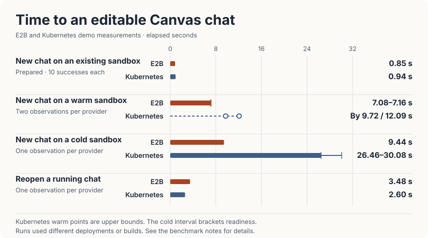
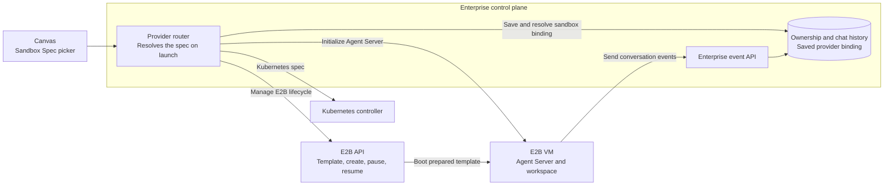

# E2B for OpenHands Enterprise

An experimental demo package for running OpenHands conversations on E2B
microVMs. Enterprise and Canvas run in Docker Compose. A Sandbox Spec
selects the VM template, and reopening a conversation follows its saved
sandbox binding.

- [Run the Compose quickstart](docs/SETUP.md#build-and-start) with the E2B
  adapter bundled in Enterprise 1.88.0.
- [Try the Canvas demo](docs/DEMO.md) covering workspace choices, Pause,
  resume, fork, and the startup comparisons.
- [Build the pinned Canvas overlay](canvas/README.md) and
  [qualify provider lifecycle](docs/SETUP.md#qualify-native-e2b-lifecycle).
- [Read the interfaces and design choices](docs/INTERFACES.md).

## Canvas startup timings

[Timing table, sample counts, and measurement notes](docs/DEMO.md#timing-the-three-startup-paths)

## Fork into a new VM

In Canvas, open an idle, running E2B conversation. Next to the conversation
title, choose **Workspace options → Fork into a new VM**. The fork opens a
new conversation on a distinct E2B VM using the same Sandbox Spec. It
carries over the chat history and workspace, including the Git commit,
uncommitted tracked edits, and untracked files. The source stays running
and later writes to the fork stay on the fork.

In one browser run on the shared AWS Compose demo, the original history
appeared **8.77 s** after clicking Fork and the composer was editable at
**8.78 s**. The action requires an eligible E2B chat and a spare VM slot.
See [setup and validation](docs/DEMO.md#fork-an-e2b-chat).

## What we demonstrated

| Capability | Where it was verified |
| --- | --- |
| Standard and Large specs, E2B or Kubernetes | Mixed-provider Enterprise Compose candidate, using Canvas and Agent Profiles |
| New chat with current files, a clean checkout on the same machine, or a separate machine | Live Canvas candidate. The separate-machine dialog was checked on both providers |
| Same-VM Pause and resume | Live E2B, with the original conversation and workspace |
| Conversation fork to a separate E2B VM | Mixed-provider Enterprise Compose candidate. The fork kept chat history and dirty Git files. Kubernetes had no fork action |
| Warm E2B claim and authenticated preview | Separate E2B candidate |
| Automatic checkpoints and replacement after provider expiry | Separate E2B candidate. The original conversation opened on a different VM with history, dirty files, and working preview |
| Same real model on both providers | DeepSeek V4.1 Flash completed the same Python fix on both, with three tests passing in independent reruns |
| Automation Sandbox Spec selection | Agent Profile selection saved on the Compose demo. The Kubernetes template-ready example completed, and the E2B run reached the selected sandbox |

The quickstart activates an E2B backend. Mixed-provider routing and the
advanced lifecycle flows require matching Enterprise and Canvas candidate
builds. This repo contains the template builder, Compose overlays, pinned
Canvas patches, and validation probes. See the [capability record](provider.json)
and [demo guide](docs/DEMO.md) for the deployment boundaries and timing details.

Enterprise uses the same Sandbox Spec ID contract for both providers. In the
single-template quickstart, `E2B_TEMPLATE` is both the spec ID and template
reference. The [profiles overlay](docs/SETUP.md#configure-small-and-large-e2b-profiles)
maps stable spec IDs to separately configured templates.

## How the integration works

| Integration choice | What it gives us | What it costs |
| --- | --- | --- |
| Prepared E2B template with deferred Agent Server init | Provision a VM with tools ready, then issue a session key when claimed | Maintain the template build and match it to Enterprise's initialization contract |
| Warm VMs scoped to a Sandbox Spec | Skip allocation when matching inventory is ready | Reserve provider capacity and refill the pool. A miss starts a new VM |
| Provider pause and a separate workspace copy for fork | Reopen the same VM or branch an existing chat and its files into an independent VM | Fork needs a spare slot and copies a bounded workspace. Recovery after expiry needs a durable checkpoint |
| E2B port URLs, with an optional authenticated preview gateway | Connect Canvas directly to Agent Server or enforce preview access at the app edge | The gateway needs its own ingress configuration. Verify that private previews are also closed on the provider URL |

[Interfaces and alternatives](docs/INTERFACES.md)
